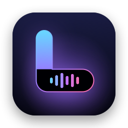
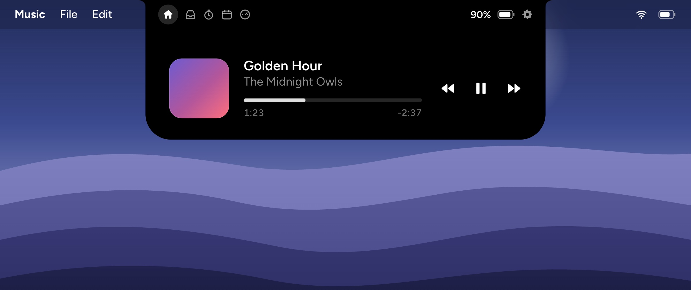
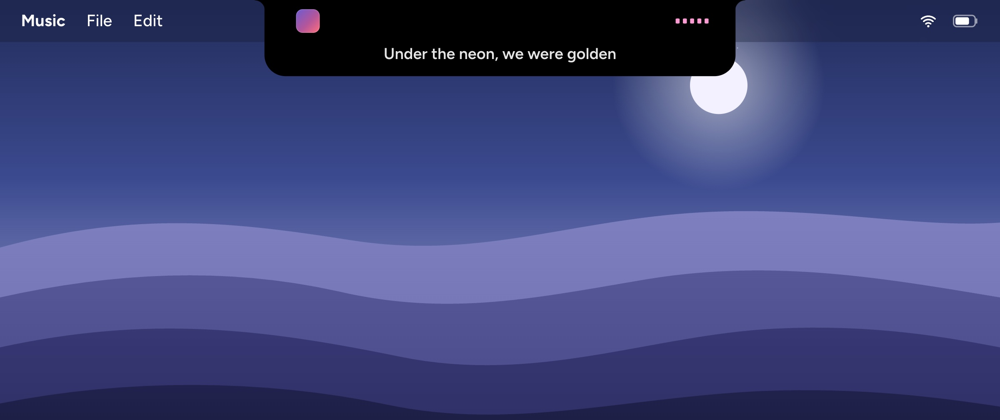
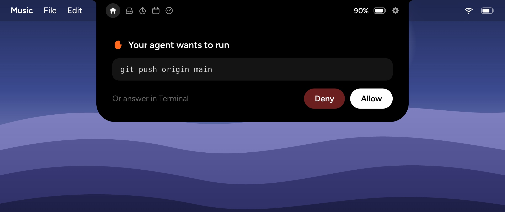
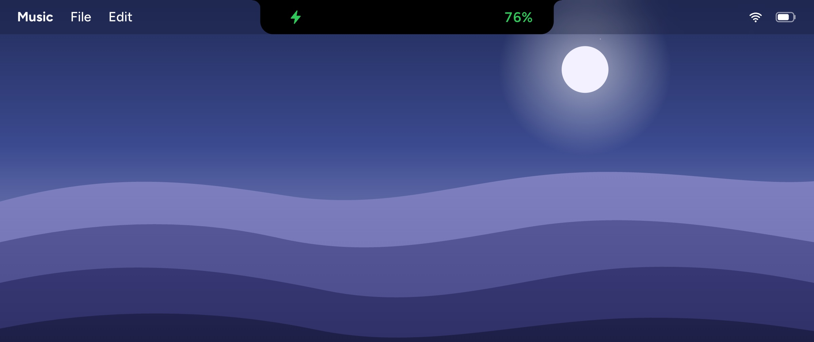
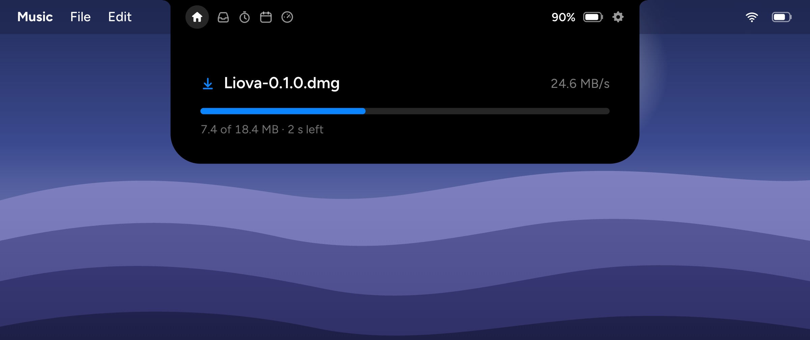

<div align="center">



# Liova

**The free, open-source notch for your Mac.**<br>
Music and lyrics, charging, AirPods, downloads and your coding agents, right where the camera is.

[](https://github.com/Krishnarajan7/Liova/actions/workflows/ci.yml)


[](LICENSE)

[**Website**](https://krishnarajan7.github.io/Liova/) · [**Get it**](#get-it) · [Docs](docs) · [Changelog](CHANGELOG.md)

<br>



</div>

## What it does

<table>
<tr>
<td width="50%"></td>
<td width="50%"></td>
</tr>
<tr>
<td><b>Now Playing and synced lyrics.</b> Any app, with the line being sung under the closed notch.</td>
<td><b>Agent Island.</b> See what Claude Code, Codex, Gemini CLI or Cursor is doing, and answer from the notch.</td>
</tr>
<tr>
<td></td>
<td></td>
</tr>
<tr>
<td><b>Charging, AirPods and headphones.</b> Battery for each bud and the case, a moment when you plug in.</td>
<td><b>Downloads.</b> Browser and Telegram downloads with speed and time left.</td>
</tr>
</table>

And a **File Shelf** with AirDrop, **volume and brightness HUDs**, **timers**, your **next meeting** with a Join button, **weather** with a rain heads-up, **camera and mic alerts**, live **system stats**, and a notch on **every display**, notched or not.

Anything can light up the notch, from any script:

```bash
liova activity start --id deploy --title "Deploying" --progress 0.4 --symbol hammer.fill
```

The same works over a local socket and `liova://` links: see the [plugin API](docs/PLUGIN-API.md).

## Get it

For Apple Silicon and Intel Macs on macOS 14 or later.

1. **[Download Liova.dmg](https://github.com/Krishnarajan7/Liova/releases/latest/download/Liova.dmg)** and drag Liova into Applications.
2. Open it. macOS says it can't verify Liova, because it isn't notarized (that needs a paid Apple account). Open **System Settings → Privacy & Security** and click **Open Anyway**. Once: updates after that install themselves.

<details>
<summary>Or build it from source (needs Xcode 26)</summary>

```bash
brew install xcodegen swiftlint swiftformat cmake
git clone https://github.com/Krishnarajan7/Liova.git && cd Liova
make setup && make run
```

</details>

Liova appears in your menu bar; choose **Show Demo Activity** to see it work. Connect your coding agents from **Settings → Agents** in one click (or `liova agents install claude-code`; see [Agent Island](docs/AGENT-ISLAND.md)). Stuck? See [Troubleshooting](docs/TROUBLESHOOTING.md).

## Light on your Mac

| Release build, MacBook Air M4 | CPU | Memory |
| --- | --- | --- |
| Idle, nothing showing | **0.0%** | ~30 MB with helpers |
| Music playing, notch closed | **~1%** with moving bars, **0.2%** without | 17–25 MB |

Nothing polls: battery, music, displays and agents all push changes to Liova, and between changes it sleeps. Every number and rule is in [PERFORMANCE.md](docs/PERFORMANCE.md).

## Private by default

- **No telemetry, ever.** Once a day Liova asks GitHub for a new version, and you can turn that off. Lyrics and weather are opt-in and send only what they need.
- **Permissions only when needed**, asked for when you turn on the feature that uses them.
- **Agent prompts stay with the agent.** Only the event, the folder name and a short tool summary reach the notch.

## Learn more

[Architecture](docs/ARCHITECTURE.md) · [Decisions](docs/DECISIONS.md) · [Roadmap](docs/ROADMAP.md) · [Distribution](docs/DISTRIBUTION.md) · [Development](docs/DEVELOPMENT.md) · [Website source](site)

## Contributing

Contributions are welcome, from bug reports to whole features. Start with [CONTRIBUTING.md](CONTRIBUTING.md): every commit needs a DCO sign-off (`git commit -s`) and a line in the [changelog](CHANGELOG.md). Good first issues are labelled `good first issue`.

## Thanks

[mediaremote-adapter](https://github.com/ungive/mediaremote-adapter) by Jonas van den Berg (BSD-3-Clause) makes Now Playing possible on modern macOS.

## License

[MIT](LICENSE) © 2026 Krishnarajan.

"Dynamic Island", "AirPods", "EarPods" and "Mac" are trademarks of Apple Inc., used here only to describe what Liova works with. Liova is not affiliated with or endorsed by Apple. Synced lyrics come from [LRCLIB](https://lrclib.net), a free community database; the lyrics belong to their rights holders, and Liova fetches them on your Mac only when you turn the feature on. Weather data by [Open-Meteo.com](https://open-meteo.com), licensed CC BY 4.0. License notices for everything Liova ships are in Settings > About > Licenses.
