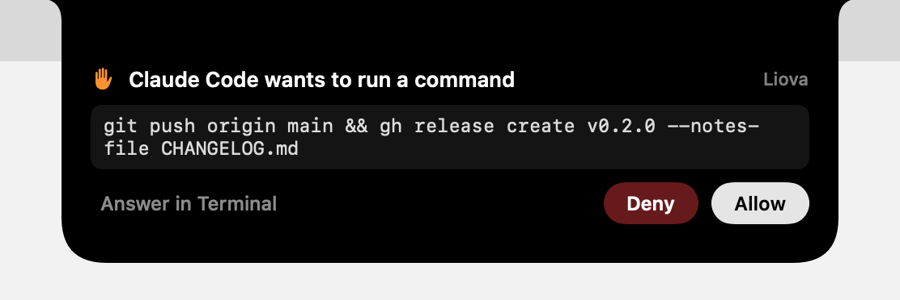
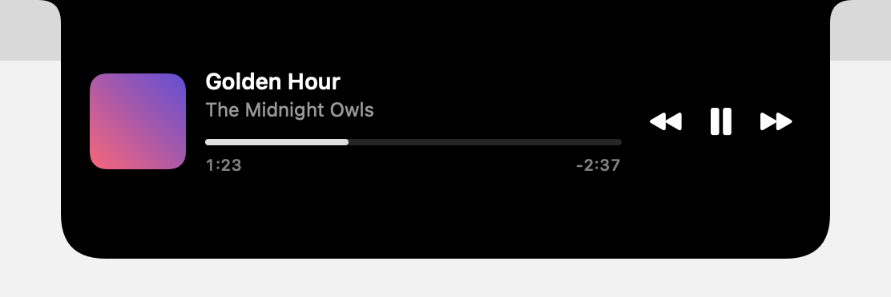
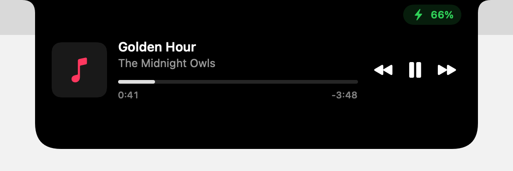
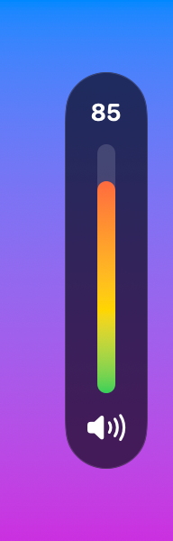
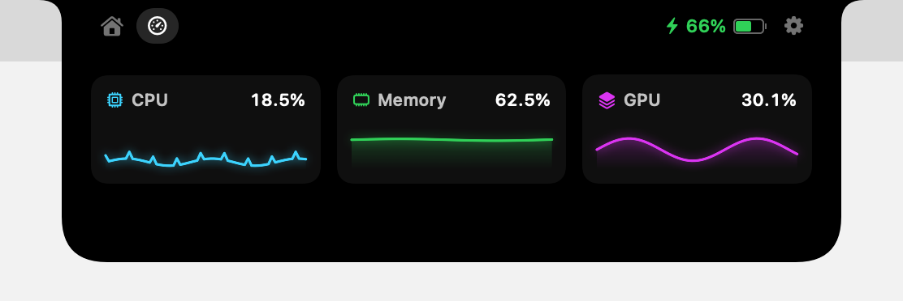

<div align="center">

# Liova

**The free, open-source Dynamic Island for your Mac.**

Music, charging, volume, your coding agents and anything your scripts want to say, in the notch.
Native Swift, smooth by design, and it uses no CPU while there's nothing to show.

[](https://github.com/Krishnarajan7/Liova/actions/workflows/ci.yml)


[](LICENSE)



</div>

> [!NOTE]
> **Early preview.** Liova builds and runs today and is used daily by its author, but there's no
> signed release yet. Build it from source (two commands, below) or ⭐ star the repo to hear when
> the first release lands.

## What it does

<table>
<tr>
<td width="50%" valign="top">

**🎵 Now Playing, from any app**<br>
Spotify, Apple Music, YouTube in your browser, podcasts. Artwork, play/pause, skip and a scrubber you can drag. Small bars move in the closed notch while music plays.



</td>
<td width="50%" valign="top">

**🤖 Agent Island**<br>
See what Claude Code is doing ("Running `swift test`", "Editing App.swift") and approve or deny its requests from the notch. One command to set up. If you ignore it, Claude simply asks in the terminal as usual.


</td>
</tr>
<tr>
<td valign="top">

**⚡ A charging moment**<br>
Plug in and a little battery fills up, a bolt pops in and a streak of light runs along the notch. Quick events show as a chip, so the notch keeps showing your music.



</td>
<td valign="top">

**🔊 A better volume and brightness HUD**<br>
Slim level bars at the edges of the screen: volume on the right, running green to red as it gets louder, and brightness on the left. Or keep them in the notch. Opt-in, and they can never break the system HUD.



</td>
</tr>
<tr>
<td valign="top">

**📊 System at a glance**<br>
Live CPU, memory and GPU with a minute of history, one tap away in the open notch. It measures only while you're looking.



</td>
<td valign="top">

**⬇️ Downloads**<br>
Browser and Telegram downloads show up with size, speed and time left, then flash when they're done. Liova only looks at file names and sizes, never their contents.

</td>
</tr>
</table>

Also:

- **Every Mac.** It matches the camera housing exactly on notched MacBooks and draws a virtual notch on everything else, including external displays, one per display.
- **Feels right.** Springs that never overshoot, a hover that ignores a passing pointer, and clicks that go straight through to the menu bar underneath.
- **Scriptable.** Anything can light up the notch:

  ```bash
  liova activity start --id deploy --title "Deploying" --progress 0.4 --symbol hammer.fill
  ```

  The same works over a local socket and `liova://` links. See the [plugin API](docs/PLUGIN-API.md).

*Screenshots are real renders of Liova's views, not mockups.*

## Get it

You'll need macOS 14 or later and Xcode 26 or later.

```bash
brew install xcodegen swiftlint swiftformat cmake
git clone https://github.com/Krishnarajan7/Liova.git && cd Liova
make setup && make run
```

Liova appears in your menu bar. Choose **Show Demo Activity** to see it work.

**Set up Agent Island for Claude Code** (optional):

```bash
make cli
build/cli/liova agents install claude-code   # adds hooks to ~/.claude/settings.json, keeps a backup
```

Undo it any time with `liova agents uninstall claude-code`. See [Agent Island](docs/AGENT-ISLAND.md) for exactly what is and isn't sent.

> [!TIP]
> Volume and brightness HUDs need the Accessibility permission. Development builds change identity
> on every rebuild, so run `make dev-cert` once to keep permissions across rebuilds.

## Built to sip battery

A notch app is on screen all day, so performance is a feature here, and we publish what we measure.

| Measured on a MacBook Air M4, Release build | Liova CPU | Memory |
| --- | --- | --- |
| Idle, nothing showing | **0.0%** | 15 MB |
| Music playing, notch closed | **~1%** with moving bars, **0.2%** without | 17–25 MB |
| Claude Code hook, per event | 17 ms, then exits | — |

How we keep it there:

- **Nothing polls.** Battery, music, displays and agents all push changes to Liova.
- **The window never moves.** Only the shape inside it animates.
- **Features render separately.** A battery tick can't redraw your music player.
- **Moving parts stay cheap.** The music bars cap their frame rate (30 fps plugged in, 20 on battery) and stop when paused, hidden or in Low Power Mode.

Every number and rule is in [PERFORMANCE.md](docs/PERFORMANCE.md).

## Private and safe by default

- **No telemetry, ever.** Liova makes no network requests of its own.
- **Permissions only when needed.** Each one is asked for only when you turn on the feature that needs it. Accessibility is used solely to read the volume and brightness keys, never what you type.
- **No private-API tricks that can bite.** Liova never freezes system processes and never pretends to be an Apple app.
- **Plugins stay outside.** They run in their own processes, and the local socket only accepts your own user account.
- **Agent prompts stay with the agent.** Agent Island sends the event type, the project folder name and a short tool summary, and never your prompt text.

## How it's built

Swift 6 with strict concurrency, SwiftUI inside AppKit panels, and one `@Observable` store per feature. Everything goes through a small priority-stack **activity engine**: a timer beats music, a volume change beats both, and each one hands the notch back when it's done.

```
App ─► LiovaUI ─► LiovaCore ─► LiovaPluginKit ◄─ LiovaIPC ◄─ liova (CLI)
          ▲            ▲
          └── LiovaFeatures ──► LiovaProviders
```

Read more in [ARCHITECTURE.md](docs/ARCHITECTURE.md) and the [decision log](docs/DECISIONS.md).

## Roadmap

- [x] Notch on every display, smooth motion, hover and click-through
- [x] Activity engine, battery, Now Playing, volume and brightness HUDs
- [x] Plugin API: CLI, socket and `liova://` links
- [x] Agent Island for Claude Code
- [x] Downloads, System page, open-notch pages with battery status
- [ ] File shelf with AirDrop
- [ ] Agent Island for Codex, Cursor and Gemini CLI
- [ ] Timers, calendar, Focus, AirPods and more live activities
- [ ] Signed releases, auto-updates and a Homebrew tap
- [ ] **v1.0, planned for February 2027**

The full plan is in [ROADMAP.md](docs/ROADMAP.md).

## Contributing

Contributions are welcome, from bug reports to whole features. Start with [CONTRIBUTING.md](CONTRIBUTING.md). Every commit needs a DCO sign-off (`git commit -s`). Good first issues are labelled `good first issue`.

## Thanks

- [mediaremote-adapter](https://github.com/ungive/mediaremote-adapter) by Jonas van den Berg (BSD-3-Clause) makes Now Playing possible on modern macOS.

## License

[MIT](LICENSE) © 2026 Krishnarajan.

"Dynamic Island" is a trademark of Apple Inc. Liova is not affiliated with or endorsed by Apple.
