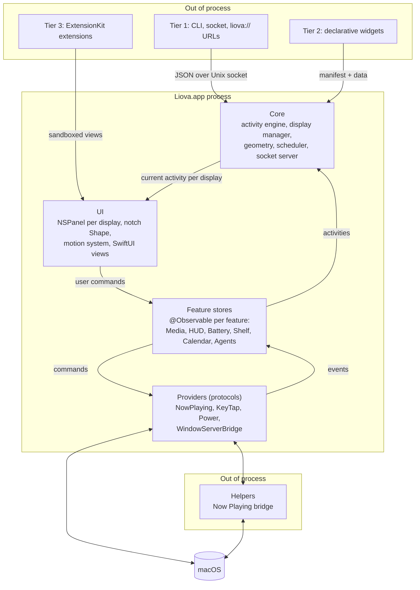
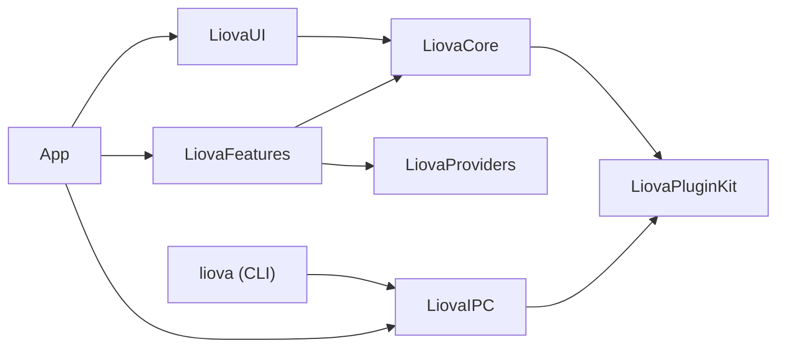

# Architecture

Liova is a native Swift 6 app: SwiftUI views inside fixed AppKit panels, a small core built around one **activity engine**, and every risky dependency (plugins, private APIs, the Now Playing bridge) kept behind a protocol or outside the process.

This document describes the target design. Some parts (feature stores, providers, plugins) are still being built; see [ROADMAP.md](ROADMAP.md).

## The six layers

| Layer | Responsibility | Where it runs |
| --- | --- | --- |
| **Plugins** | Third-party and first-party extensions in three tiers (below) | Out of process |
| **UI** | One `NSPanel` per display, the notch `Shape`, hover and hit-testing, the shared motion system, SwiftUI views | Main actor |
| **Core** | Activity engine, display manager, notch geometry, visibility-aware scheduler, socket server | Main actor for engine state; actors for I/O |
| **Feature stores** | One `@Observable` store per feature, owning that feature's state and turning provider events into activities | Main actor |
| **Providers** | Protocol-wrapped access to the system: Now Playing, key events, power, window server. Each has a real and a fake implementation | Actors / background executors |
| **Helpers** | Separate processes for anything risky or fragile, starting with the Now Playing bridge | Out of process |

## Event flow

Data flows **up**, commands flow **down**.

1. **Providers** listen to push sources (power notifications, Core Audio property listeners, `NSWorkspace` notifications, EventKit changes, the Now Playing helper in diff mode). They never poll in a loop.
2. Providers deliver typed events to their **feature store**. The store updates its own state and drops duplicates.
3. When something is worth showing, the store **publishes an activity** to the activity engine (start, update, or end).
4. The **activity engine** decides what each display shows and hands the result to the **UI**.
5. **Views** read only the store properties they render, so an update to one feature re-renders only that feature's views.
6. User input (click, swipe, scrub, approve) becomes a **command** sent to the store, which calls its provider. Views never talk to providers directly.

Plugins enter at step 3: a tier 1 push over the socket becomes an activity exactly like a first-party one.

## The activity engine

The engine is a **priority stack** of live activities. Each activity has an ID, a source, a priority, an optional expiry, and compact and expanded presentations.

- The highest-priority activity is shown.
- A new higher-priority activity **preempts** the current one. The preempted activity stays on the stack, still receiving updates.
- When the top activity ends or expires, the one beneath it is **restored**, with its latest state.
- Equal priorities: the most recent wins.

Example: music is playing (low priority). A timer starts (medium) and takes the notch. The volume key is pressed, so a volume HUD (high, 1.5 s expiry) briefly covers both. When it expires, the timer comes back; when the timer ends, music returns.

The engine is pure logic in `LiovaCore` with no UI dependency, and is unit-tested directly.

## Windows: one fixed panel per display

- Each display gets **one `NSPanel`**, sized for the largest expanded state, created once and **never resized or animated**. Panels are keyed by display UUID and reconciled when displays change, not torn down and rebuilt.
- The notch is a SwiftUI `Shape` with animatable radii. Only the content inside the panel animates.
- The panel sits one level above the status bar (`statusBar + 1`), on every Space including full-screen ones, and never becomes key, so it can't steal focus.
- **Click-through:** the panel ignores mouse events everywhere except the notch's *hot zone* (the shape plus a few points of slop, including the top edge of the screen). Outside it, clicks go straight to the menu bar and apps underneath.
- **Hover:** a `PointerMonitor` listens for mouse-moved and mouse-down events (a global monitor for other apps, a local one for our panels). It's event-driven: when the mouse is still, nothing runs, and it needs no permission. Each move is one rectangle check per display. See ADR-012.
- **Interaction state machine:** `NotchInteraction` is a pure struct (`closed → peek → expanded`). With open-on-hover, resting on the notch for the hover delay opens it in a single motion (a passing pointer changes nothing); with click-to-open, hovering shows a small peek. Content always follows the shape: it fades out before the shape moves and fades in once the shape has nearly settled, so nothing is ever drawn outside the notch mid-animation. The surface renders in one GPU pass (`drawingGroup`) and has no animated shadow, leaving an open notch closes after a 180 ms grace period, and clicking outside closes immediately. It returns timer effects that the controller runs as cancellable tasks, so a stale timer can never open or close the notch.
- **Geometry** is a pure struct. On a notched display, width comes from the gap between `auxiliaryTopLeftArea` and `auxiliaryTopRightArea`, and height from `safeAreaInsets.top`. Displays without a notch get a virtual notch of the same proportions.
- The notch is drawn solid black so it blends with the camera housing. Liquid Glass (macOS 26, via `#available`) is planned for expanded surfaces only.
- `NotchSystem` keeps one `NotchController` per selected display, keyed by display UUID; each controller owns its panel, its `NotchModel` (view state) and its `NotchInteraction`.

## Plugin tiers

All three tiers keep plugin code **out of the Liova process**.

| Tier | What it is | Trust model |
| --- | --- | --- |
| **1. Anything can push** | A local Unix-socket JSON API, the `liova` CLI, and `liova://` URLs. Example: `liova activity start --id build --title "Deploying" --progress 0.4`. Powers Agent Island. | Socket directory is `0700`; every connection's peer UID must match the current user; messages are size-limited and schema-validated. |
| **2. Declarative widgets** | A JSON manifest plus a script or HTTP data source. Liova renders it with built-in SwiftUI templates (progress, list, gauge, media). | No plugin code runs inside Liova; scripts run as separate processes. |
| **3. Native extensions** | A Swift SDK built on Apple's ExtensionKit. Extensions run in their own sandboxed process and the system draws their SwiftUI views in our panel. | Signed bundles only, OS-enforced sandbox. |

First-party features use the same models from `LiovaPluginKit` as third parties, which keeps the core small and the SDK honest.

### Custom activity views

The notch renders every activity the same way by default: a symbol, a title and optional progress. A feature that needs more (Now Playing's artwork, scrubber and controls) registers an `ActivityRenderer` for its source in the `ActivityRendererRegistry`. The renderer supplies the compact left and right "ears" and the expanded card; anything it returns `nil` for falls back to the defaults. The notch itself never knows about media, so features stay out of `LiovaUI` and the same hook can later serve native plugins.

### Now Playing

`MediaRemoteAdapterProvider` runs the vendored [mediaremote-adapter](../Vendor/mediaremote-adapter/VENDORED.md) under `/usr/bin/perl` in `stream` mode: a push-based child process that writes one JSON line per change. Lines are parsed off the main thread (artwork arrives as large base64 strings) and delivered in order; the helper is restarted with backoff if it dies. `NowPlayingFeature` decodes artwork once, downsampled with ImageIO, and publishes a low-priority `system.media` activity, so any other activity preempts the music and the music comes back when it ends. Paused media leaves after 10 minutes.

### Volume and brightness HUDs

Off by default. Two styles: a vertical **side bar** at the right edge of the screen (default; a click-through panel that's ordered out between presses) or **in the notch**. When turned on, a `CGEventTap` that listens only for media-key events (never ordinary typing) applies the change through Core Audio or DisplayServices and shows a 1.5 s critical-priority `system.hud` activity, so it covers everything and then restores what was there. No system process is ever suspended; if the tap fails or macOS keeps disabling it, Liova removes it and the system overlay simply returns. Holding Option at launch (or `LIOVA_SAFE_MODE=1`) starts Liova with HUDs off. Details: [HUD.md](HUD.md).

### Agent Island

Coding agents report what they're doing through their own hook systems. The `liova` CLI translates each agent's hook format into Liova's agent-agnostic vocabulary (`AgentEvent`, `AgentPermissionRequest`) and sends it over the plugin socket; the app never parses agent-specific formats. `AgentIslandFeature` keeps one activity per session (updated in place, `normal` priority while working, `low` while idle, a brief `high` flash when a turn finishes) under the reserved `system.agents` source.

A permission request is the one call that waits: the socket request stays open while a `high`-priority prompt with Allow / Deny is shown (and, by default, the notch opens on the display with the pointer). It resolves on the user's answer, on its deadline, or when the session moves on without it (answered in the terminal). Every non-answer resolves to `ask`, which tells the agent to show its own prompt, so Liova can never block an agent. Details: [AGENT-ISLAND.md](AGENT-ISLAND.md).

### The plugin trust boundary

Every command from outside Liova goes through `ActivityCommandExecutor` (in `LiovaCore`) before it reaches the engine. The socket server has already checked the peer's user ID, the size and the schema; the executor adds the ownership rules:

| Rule | Why |
| --- | --- |
| `system.*` activities can't be started, updated or ended from outside | Built-in features (battery, HUDs) can't be spoofed or dismissed by scripts |
| A `start` can't reuse an ID that another source owns | One tool can't hijack another tool's activity |
| `liova://` links may only change activities that links created, at most `normal` priority, with a TTL of at most one hour | Any app or web page can open a link, so links get the least power |

The app target only wires it up: the socket handler and `application(_:open:)` both call the executor, with origin `.socket` or `.url`.

## Module boundaries

All modules live in one local Swift package, `Packages/LiovaKit`, as separate targets. The `App` target depends on the package.

| Module | Contents today |
| --- | --- |
| `LiovaPluginKit` | `Activity`, `ActivityID`, `ActivityPriority`, `ActivityTint`, the wire protocol |
| `LiovaCore` | `ActivityEngine`, `ActivityCommandExecutor`, `NotchGeometry`, `DisplayManager`, `LiovaSettings`, `Log` |
| `LiovaUI` | `NotchShape`, `NotchLayout`, `NotchInteraction`, `NotchController`, `NotchSystem`, `PointerMonitor`, `ActivityRendererRegistry`, `Motion`, views |
| `LiovaProviders` | `PowerSourceProviding` + `IOKitPowerSource`; `NowPlayingProviding` + `MediaRemoteAdapterProvider`; HUD providers (volume, brightness, media-key tap) |
| `LiovaFeatures` | `BatteryFeature`, `NowPlayingFeature` + `NowPlayingRenderer`, `HUDFeature`, each with a pure, tested policy |
| `LiovaIPC` | Socket server and client, `liova://` URL parser |
| `liova` | The command-line tool |

Dependency rules, enforced in review:

| Module | May depend on | Must not |
| --- | --- | --- |
| `LiovaPluginKit` | Nothing (Foundation only) | Import any other Liova module, AppKit, or SwiftUI. It's the public SDK; plugins compile against it alone. |
| `LiovaCore` | `LiovaPluginKit` | Import SwiftUI or draw anything. Pure logic: engine, geometry, scheduler, display model. (`DisplayManager` reads `NSScreen`; that is its only AppKit use.) |
| `LiovaUI` | `LiovaCore`, `LiovaPluginKit` | Contain feature-specific logic. |
| `Providers/*` | `LiovaPluginKit` (and system frameworks) | Import UI modules or other providers. |
| `Features/*` | `LiovaCore`, `LiovaUI`, provider **protocols** | Import other features. Talk to each other only through the activity engine. |
| `App` | Everything | Contain logic. It wires dependencies together, creates panels, and owns the app lifecycle. Nothing more. |

Other rules:

- **No singletons.** Dependencies are passed in through initializers from `App`.
- **No root `ObservableObject`.** Each feature owns its `@Observable` store.
- **Swift 6 strict concurrency** in every target. UI and store state are `@MainActor`; I/O lives in actors.

## Private-API isolation

A notch app needs a few things public APIs don't provide, most notably drawing above fullscreen apps. We contain this:

- Every private window-server call lives in **one module, `WindowServerBridge`**, behind a protocol.
- Symbols are resolved at runtime with `dlsym`, never linked directly. A missing symbol is not a crash.
- If anything is unavailable, the bridge **falls back to public APIs**: standard `NSPanel` window levels, and hiding the notch while a fullscreen app is active.
- Beta CI runs on each new macOS seed to catch changes early.

Things we never do, whatever the benefit: impersonate Apple bundle IDs (`com.apple.*`), suspend system processes with `SIGSTOP`, or disable library validation. Now Playing goes through the BSD-licensed [mediaremote-adapter](https://github.com/ungive/mediaremote-adapter) bridge in a helper; volume and brightness HUDs use an event tap with a watchdog that restores normal key handling if the tap is disabled. See [DECISIONS.md](DECISIONS.md) for the reasoning.

## Dependencies

All third-party dependencies are permissively licensed. Planned: Sparkle (MIT), Defaults (MIT), KeyboardShortcuts (MIT), mediaremote-adapter (BSD-3-Clause), swift-collections (Apache-2.0). No GPL anywhere in the tree.
